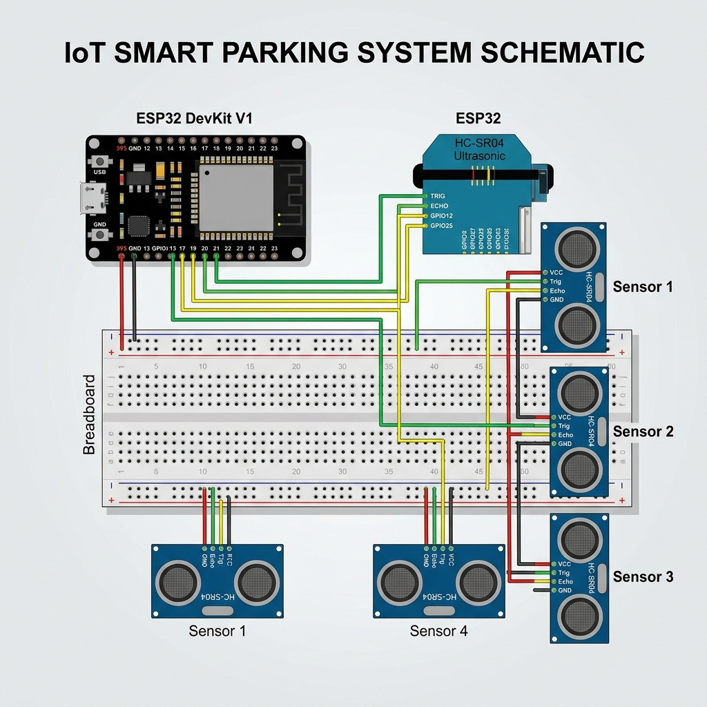
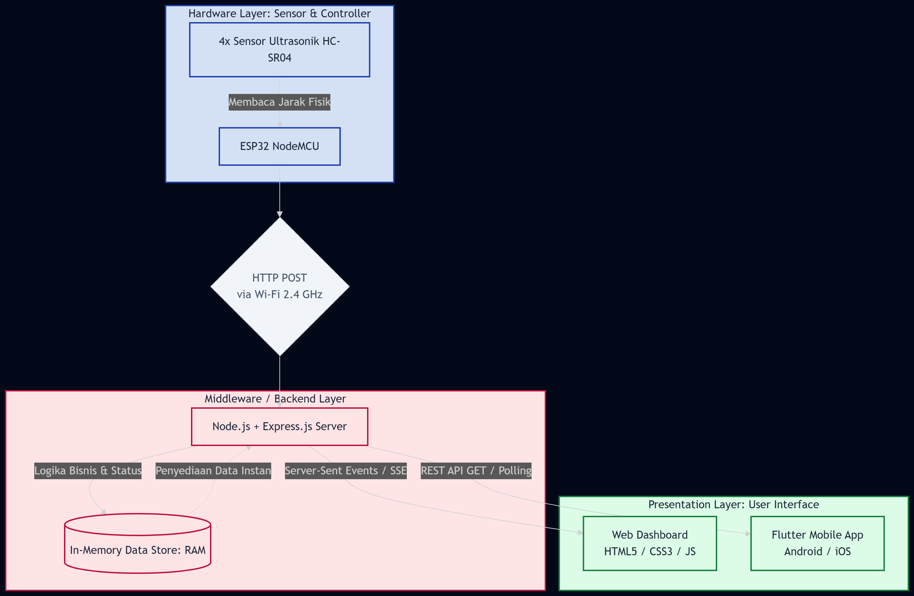
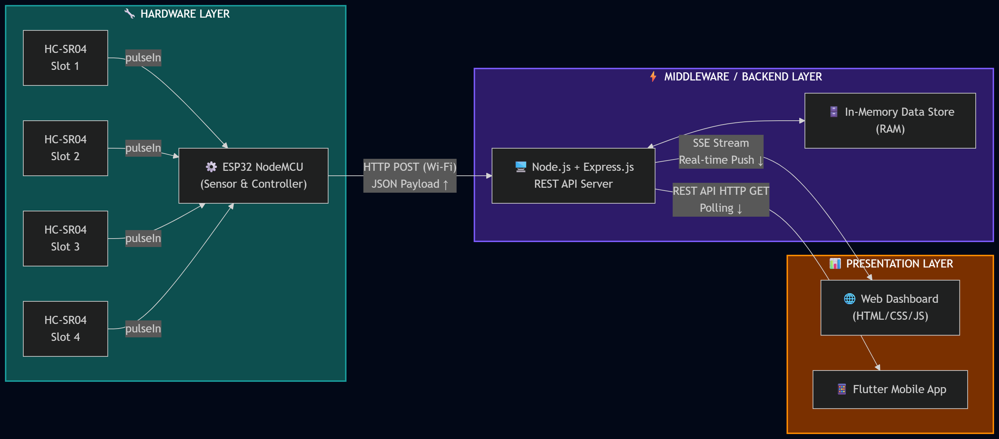

# 🚗 ParkSmart - IoT Smart Parking Mobile App

Aplikasi mobile berbasis **Flutter** untuk memantau ketersediaan slot parkir secara *real-time* berbasis IoT (Internet of Things). Aplikasi ini terhubung langsung ke backend server / mikroprosesor IoT (seperti Node.js, ESP32, atau sensor ultrasonik) untuk menampilkan status parkir, jarak deteksi sensor, estimasi latensi, serta peta lokasi area parkir.

---

## 📋 Daftar Isi
- [Fitur Utama](#-fitur-utama)
- [Arsitektur Sistem & Skema Hardware](#-arsitektur-sistem--skema-hardware)
- [Prasyarat Sistem](#-prasyarat-sistem)
- [Langkah Instalasi (Dari Clone ke Run)](#-langkah-instalasi-dari-clone-ke-run)
- [Konfigurasi Server / Backend API](#-konfigurasi-server--backend-api)
- [Cara Menjalankan Aplikasi](#-cara-menjalankan-aplikasi)
- [Panduan Penggunaan Aplikasi](#-panduan-penggunaan-aplikasi)
- [Build APK untuk Android](#-build-apk-untuk-android)
- [Struktur Direktori Proyek](#-struktur-direktori-proyek)
- [Tim Pengembang](#-tim-pengembang)

---

## ✨ Fitur Utama

- **Real-time Slot Monitoring:** Status slot parkir dinamis (*Tersedia* / *Terisi*) dengan animasi visual slot.
- **Sensor Distance & Latency Indicator:** Menampilkan pembacaan jarak sensor dalam centimeter (cm) dan latensi respon API dalam milidetik (ms).
- **Auto-Refresh Data:** Pembaruan data otomatis setiap 3 detik dengan indikator koneksi backend (*Online* / *Offline*).
- **Peta Lokasi Interaktif:** Integrasi peta (*OpenStreetMap* via `flutter_map`) untuk melihat titik lokasi parkir dan status node sensor aktif.
- **Konfigurasi API Fleksibel:** Pengaturan Base URL API langsung dari dalam aplikasi tanpa perlu compile ulang (tersimpan di *SharedPreferences*).
- **Preset Alamat Server:** Pilihan cepat untuk Android Emulator, Localhost, dan Local Wi-Fi.

---

## 📐 Arsitektur Sistem & Skema Hardware

### 1. Skema Hardware IoT (ESP32 & Sensor Ultrasonik HC-SR04)
Rangkaian mikrokontroler ESP32 DevKit V1 yang terhubung ke 4 sensor ultrasonik HC-SR04 melalui breadboard untuk mendeteksi keberadaan kendaraan pada masing-masing slot parkir:

<p align="center">
  
</p>

### 2. Arsitektur Sistem 3-Tier
Alur arsitektur menyeluruh dari Hardware Layer (ESP32 & Sensor HC-SR04), Middleware/Backend Layer (Node.js & Express.js REST API / SSE), hingga Presentation Layer (Web Dashboard & Flutter Mobile App):

<p align="center">
  
</p>

### 3. Diagram Alur Data & Protokol Komunikasi
Rincian transmisi data mulai dari pembacaan sinyal jarak sensor (`pulseIn`), pengiriman payload JSON via HTTP POST (Wi-Fi 2.4 GHz), penyimpanan in-memory RAM, hingga distribusi data real-time via Server-Sent Events (SSE) dan REST API HTTP Polling ke klien:

<p align="center">
  
</p>

---

## 🛠️ Prasyarat Sistem

Sebelum menginstal, pastikan komputer Anda telah terpasang:
1. **Git**: [Unduh Git](https://git-scm.com/downloads)
2. **Flutter SDK** (Versi 3.10.0 atau lebih baru): [Panduan Instalasi Flutter](https://docs.flutter.dev/get-started/install)
3. **Android Studio** atau **VS Code** (dengan ekstensi Flutter & Dart terpasang)
4. **Android SDK & Device / Emulator** (jika menjalankan di Android) atau browser **Google Chrome** (jika menjalankan di Web)

> **Verifikasi Instalasi:** Jalankan perintah berikut di terminal/PowerShell untuk memastikan lingkungan Flutter sudah siap:
> ```bash
> flutter doctor
> ```

---

## 🚀 Langkah Instalasi (Dari Clone ke Run)

Ikuti langkah-langkah berikut secara berurutan:

### 1. Clone Repository dari GitHub
Buka terminal / PowerShell / Git Bash di folder yang Anda inginkan, lalu jalankan:
```bash
git clone https://github.com/Andrew2509/smartparking.git
```

### 2. Masuk ke Folder Proyek
```bash
cd smartparking
```

### 3. Unduh Semua Dependency
Unduh seluruh library yang dibutuhkan proyek:
```bash
flutter pub get
```

---

## ⚙️ Konfigurasi Server / Backend API

Aplikasi ini memerlukan backend API untuk menyuplai data sensor parkir.

### Format Respon JSON yang Diharapkan:
Endpoint API (misalnya `GET /api/parking`) harus mengembalikan JSON dengan struktur:
```json
{
  "success": true,
  "data": [
    {
      "slot": 1,
      "status": "Tersedia",
      "distance": 45,
      "updatedAt": "2026-10-13T09:00:00.000Z"
    },
    {
      "slot": 2,
      "status": "Terisi",
      "distance": 12,
      "updatedAt": "2026-10-13T09:00:00.000Z"
    }
  ]
}
```

### Konfigurasi Alamat IP Backend:
Anda dapat mengatur URL API langsung melalui aplikasi di menu **Pengaturan (Settings)**:
- **Jika memakai Android Emulator:** Gunakan `http://10.0.2.2:5001/api/parking` (10.0.2.2 adalah alias localhost komputer dari emulator Android).
- **Jika memakai Browser (Web):** Gunakan `http://localhost:5001/api/parking`.
- **Jika memakai HP Android Fisik:** Hubungkan HP dan laptop ke jaringan Wi-Fi yang sama, lalu gunakan IP lokal laptop Anda (contoh: `http://192.168.1.15:5001/api/parking`).

---

## 📱 Cara Menjalankan Aplikasi

Pastikan ada perangkat yang aktif (HP tersambung via USB debugging, emulator menyala, atau Chrome).

### 1. Cek Perangkat yang Terdeteksi
```bash
flutter devices
```

### 2. Jalankan Aplikasi

- **Menjalankan pada perangkat default:**
  ```bash
  flutter run
  ```

- **Menjalankan di Google Chrome (Web Mode):**
  ```bash
  flutter run -d chrome
  ```

- **Menjalankan di Emulator / Perangkat Tertentu:**
  ```bash
  flutter run -d <DEVICE_ID>
  ```
  *(Ganti `<DEVICE_ID>` dengan ID perangkat yang muncul pada `flutter devices`)*

---

## 📖 Panduan Penggunaan Aplikasi

1. **Dashboard (Menu Utama)**
   - Menampilkan ringkasan total slot parkir, jumlah slot terisi, dan slot kosong.
   - Kartu visual masing-masing slot parkir dengan status warna (Hijau: Tersedia, Merah: Terisi).
   - Terdapat tombol **Refresh Manual** dan indikator status latensi real-time.

2. **Peta Lokasi (Tab Location)**
   - Menampilkan visualisasi peta lokasi area parkir.
   - Daftar sensor node aktif di lapangan beserta data telemetri.

3. **Pengaturan (Tab Settings / Ikon Gear)**
   - Masukkan Base URL backend Anda pada kolom input.
   - Gunakan tombol preset (Android Emulator / Localhost / WiFi) untuk kemudahan pengisian.
   - Tekan tombol **"Uji Koneksi & Simpan"** untuk memverifikasi apakah aplikasi berhasil terhubung ke server backend.

4. **Info Tim (Tab Team)**
   - Menampilkan profil tim pengembang IoT dan referensi dokumentasi proyek.

---

## 📦 Build APK untuk Android

Jika Anda ingin menghasilkan file installer `.apk` mandiri untuk diinstal ke HP Android tanpa harus menyalakan komputer:

```bash
flutter build apk --release
```

File APK akan tersedia di:
```
build/app/outputs/flutter-apk/app-release.apk
```
Kirim file APK tersebut ke smartphone Android Anda dan lakukan instalasi.

---

## 📁 Struktur Direktori Proyek

```
smartparking/
├── android/               # Konfigurasi native Android & Gradle
├── docs/                  # Dokumentasi skema hardware & diagram arsitektur
│   ├── mermaid-diagram-2026-06-29-073609.png
│   ├── mermaid-diagram-2026-06-29-074023.png
│   └── skema_hardware.png
├── lib/
│   ├── main.dart          # Entry point aplikasi & tema Material 3
│   ├── screens/
│   │   ├── dashboard_screen.dart # Layar utama pemantauan slot
│   │   ├── location_view.dart    # Peta dan status sensor node
│   │   ├── settings_screen.dart  # Pengaturan URL API & uji koneksi
│   │   └── team_pdf_view.dart    # Profil tim & referensi proyek
│   ├── services/
│   │   └── api_service.dart      # HTTP client & parser data model parkir
│   └── widgets/
│       └── dashed_rect_painter.dart # Custom widget visual slot parkir
├── pubspec.yaml           # Daftar dependency package Flutter
└── README.md              # Dokumentasi proyek
```

---

## 👥 Tim Pengembang

Proyek **Smart Parking IoT** dikembangkan oleh:
- **Muhamad Hamzah** – *Lead Architect*
- **M. Reza Syahputra** – *Backend Specialist*
- **M. Alif Arrosyid** – *Hardware Developer*
- **Princenton Andrew** – *UX Strategist*

---

## 📄 Lisensi

Proyek ini dibuat untuk keperluan akademik dan demonstrasi IoT. Bebas dikembangkan dan dimodifikasi sesuai kebutuhan sistem parkir cerdas Anda.
